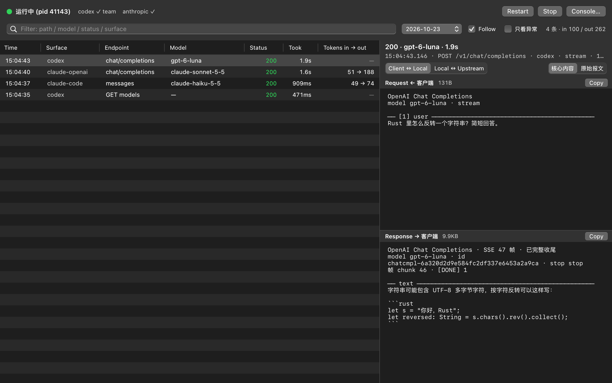

# jj-agentic-traffic

把已有的 Claude Pro / ChatGPT Plus 订阅额度，接到任何支持自定义 base url 的客户端上使用，不产生 API 账单。

形态是一个 macOS app：登录、启停、查看请求往返都在同一个窗口内完成；随附的同名终端命令提供完全一致的能力。



## 一、安装

系统要求 macOS 13 及以上。在 [Releases](https://github.com/yigegongjiang/jj-agentic-traffic/releases/latest) 页下载与本机架构对应的 `.dmg`：

<!-- prettier-ignore -->
| 机型 | 安装包 |
| --- | --- |
| Apple 芯片（M1 及之后） | `jj-agentic-traffic-macos-arm64.dmg` |
| Intel | `jj-agentic-traffic-macos-x86_64.dmg` |

打开 dmg，将图标拖入「应用程序」，双击运行。

首次运行会被 macOS 拦截，提示「未打开」「Apple 无法验证……是否包含恶意软件」。本 app 未购买 Apple 开发者签名，需手动放行一次：**系统设置 → 隐私与安全性 → 页面底部 → 「仍要打开」**，随后再次双击即可正常启动。该操作只需执行一次。

启动后 app 会弹出终端命令的安装提示，点「好」即写入 `~/.local/bin`。

升级：下载新版 `.dmg`，同样拖入「应用程序」覆盖，再打开 app 点击 **Restart**。

## 二、登录与启动

1. 点击 **Console…**，按订阅类型选择 **Login Codex**（ChatGPT Plus）或 **Login Anthropic**（Claude Pro），在浏览器中完成授权。两种订阅都持有时可分别登录。
2. 返回主窗口点击 **Start**。状态指示灯转绿并显示出账号与套餐即为运行中，此时该按钮变为 **Restart**；停止服务点 **Stop**。

服务以后台进程常驻，关闭窗口不会停止。

## 三、客户端配置

所有客户端填同一个 base url：**`http://127.0.0.1:10010`**

- **api key**：不填 / 填任意内容。
- **model**：可用取值见 **Console… → Models**。`claude-*` 走 Claude Pro 订阅，其余走 ChatGPT Plus 订阅
- 接口类型不限：OpenAI Chat Completions、OpenAI Responses、Anthropic Messages 均由该地址提供
- base url 结尾的 `/v1` 加与不加均可
- 客户端只接受 Codex 订阅地址时，填 `http://127.0.0.1:10010/backend-api/codex`。部分平台会自行拼接 url path，可依次尝试 `xxx:10010`、`xxx:10010/backend-api`、`xxx:10010/backend-api/codex`

## 四、查看请求往返

主窗口逐条列出经过的请求：时间、入口、端点、model、状态码、耗时、请求与响应字节数。

- 顶部输入框按 path、model、状态码、入口过滤；右侧日期选择器切换到往日记录
- 勾选 **Follow** 自动跟随最新一条
- 选中某行后，右侧分 **Request** / **Response** 两栏展示，各带两组切换：
  - **Client ↔ Local** / **Local ↔ Upstream**：客户端发来的原始内容，或本机实际发往上游的内容
  - **核心内容** / **原始报文**：只看对话正文，或看完整报文
- 流式响应已重新组装为完整对话，不再是分片

记录按天存放于 `~/.config/jj-agentic-traffic/log/`，不会自动清理。

## 五、终端命令

app 上的按钮与下列子命令一一对应：

```bash
jj-agentic-traffic                # 启动（已在运行则重启）
jj-agentic-traffic stop           # 停止
jj-agentic-traffic status         # 运行状态、账号、套餐
jj-agentic-traffic models         # 当前可用的 model
jj-agentic-traffic logs -n 20     # 最近 20 条往返摘要
jj-agentic-traffic login codex    # 或 login anthropic
jj-agentic-traffic logout all     # 或 logout codex / logout anthropic
```

提示找不到命令时，将 `~/.local/bin` 加入 `PATH`。

## 注意事项

- **所有端口只监听 `127.0.0.1`**，其他设备无法连接。端口不做鉴权，本机任何进程都能使用订阅额度并读取全部记录

端点字段、记录格式与整体架构见 [ARCHITECTURE.md](./ARCHITECTURE.md)。
